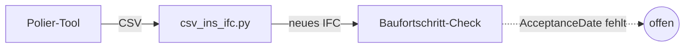
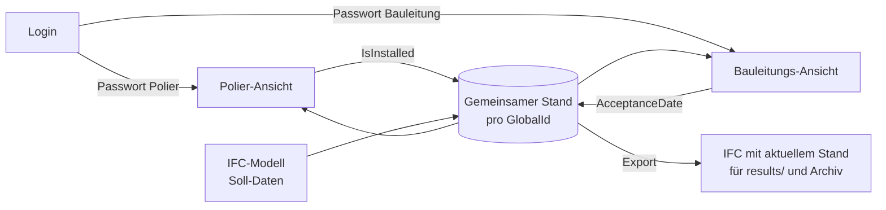

# Konzept · Baustellen-App (Polier-Tool und Baufortschritt-Check zusammenführen)

Stand 03.11.2026 · Entwurf zur Diskussion im Team · Prototyp von Variante A: [`apps/baustellen-app/`](../apps/baustellen-app/Anleitung.md)

## Ziel

Polier-Tool und Baufortschritt-Check werden **eine** Anwendung mit zwei Rollen:

| Rolle | Zugang | Sieht | Darf ändern |
|---|---|---|---|
| Polier | Passwort Polier | Polier-Ansicht: heute fällig, überfällig, montiert, 3D | `IsInstalled` (nicht bei abgenommenen Bauteilen) |
| Bauleitung | Passwort Bauleitung | Baufortschritt-Check: Übersicht, drei Anforderungen, Pendenzen, Verzug, Bericht | `AcceptanceDate`; `IsInstalled` zurücksetzen bei Fehlmeldung |
| Modellautor | – (Autorensoftware) | – | `InstallationDate` (Soll-Datum), unverändert wie heute |

Die **CSV-Schnittstelle fällt weg**: Polier-Export, `csv_ins_ifc.py` und das manuelle Laden des zurückgeführten Modells entfallen. Beide Rollen arbeiten auf **demselben Datenstand**. Nebenbei schliesst sich die offene Lücke: Die Bauleitung setzt `AcceptanceDate` direkt im Tool (siehe [AIA-BEP-Matrix](../requirements/aia-bep-matrix.md), Abschnitt «Werkzeuge»).

## Heute und künftig

**Heute:** fünf Schritte und drei Dateien pro Tag.

**Künftig:** ein gemeinsamer Datenstand, zwei Rollen.

Kernidee: Das IFC-Modell liefert Geometrie und Soll-Daten. Die Rückmeldungen (`IsInstalled`, `AcceptanceDate`) liegen als **Statustabelle pro GlobalId** in einem gemeinsamen Speicher. Daraus entsteht jederzeit ein IFC mit aktuellem Stand. Prüflogik und Statustabelle bleiben unverändert (MVP, Abschnitt 3).

## Varianten

| | A · Eine HTML-Datei, IFC als Austausch | B · Web-App mit Server (empfohlen als Ziel) |
|---|---|---|
| Aufbau | Polier-Tool und Check in einer HTML-Datei. Die Rolle wählt man per Passwort. Die App schreibt `IsInstalled` bzw. `AcceptanceDate` **direkt ins IFC** und speichert ein neues IFC. | Eine Web-App (z. B. Next.js) mit Datenbank (Statustabelle pro GlobalId) und Login. Das IFC liegt einmal auf dem Server. |
| CSV | entfällt | entfällt |
| Austausch | Das IFC wird über einen gemeinsamen Ordner weitergegeben (Teams/OneDrive). | keiner: Beide sehen sofort denselben Stand. |
| Passwortschutz | **nur symbolisch**: Der Code liegt im Browser und im öffentlichen Repo, ein Passwort lässt sich umgehen. | **echt**: Prüfung auf dem Server, Passwörter nur als Hash, Rechte pro Rolle serverseitig |
| Mehrere Poliere gleichzeitig | Konfliktgefahr, wenn zwei dasselbe IFC bearbeiten | kein Problem: Jede Meldung ist ein eigener Datensatz |
| Protokoll | – | Wer hat wann was gemeldet. Damit gibt es auch ein **Ist-Datum der Montage**, das dem MVP heute fehlt. |
| Offline auf der Baustelle | ja | nur mit Zusatz (Offline-Speicher und spätere Synchronisation) |
| Aufwand | klein: bestehende Tools zusammenführen, IFC-Schreiben ergänzen | mittel bis gross: Server, Datenbank, Hosting, Login |
| Passt zu | MVP v0.2 bis Dezember | Ausblick, Poster |

**Vorschlag:** Für den MVP **Variante A** umsetzen und **Variante B** als Zielbild auf dem Poster zeigen. Variante A erfüllt die Vorgaben (zwei Rollen, Passwort, kein CSV) mit wenig Aufwand. Die Grenzen beim Passwortschutz und beim gleichzeitigen Arbeiten müssen wir offen benennen.

## Variante A im Detail

**Login**
- Startseite mit Passwortfeld. Je nach Passwort öffnet die App die Polier- oder die Bauleitungs-Ansicht.
- Im Code stehen nur Hashes der Passwörter (SHA-256), nicht die Passwörter selbst. Die Passwörter selbst verteilen wir ausserhalb des Repos.
- Eine Rolle sieht nur die Bedienelemente, die sie braucht. Die Rechte prüft der Code zusätzlich vor jeder Änderung.

**Ablauf an einem Tag**
1. Bauleitung legt das aktuelle IFC in den gemeinsamen Ordner (z. B. `Baustelle/aktuell.ifc`).
2. Polier: Login → IFC öffnen → Bauteile als montiert melden → **«Stand speichern»** speichert `…_stand_<Datum>.ifc` mit `IsInstalled` im Modell → zurück in den Ordner.
3. Bauleitung: Login → dieses IFC öffnen → Check läuft sofort → vor Ort kontrollieren → **«Abnahme setzen»** pro Bauteil oder für eine Auswahl → **«Stand speichern»** → neues IFC in den Ordner.
4. Der **Bericht** (CSV/PDF für `results/`) bleibt als Export der Bauleitung erhalten. Er ist ein Prüfbericht, keine Schnittstelle.

**Technik**
- IFC lesen: der IFC-Leser des Baufortschritt-Checks (ohne Bibliothek) oder web-ifc wie im Polier-Tool. 3D-Ansicht aus dem Polier-Tool.
- IFC schreiben: nur die Werte in `Pset_InstallationOccurrence` ändern (`IFCBOOLEAN(.T.)`, `IFCLABEL('2026-11-03')`). Fehlt ein Pset, wird es angelegt (Regeln aus `csv_ins_ifc.py` übernehmen). Alle anderen Zeilen der Datei bleiben unverändert.
- Regeln, die heute `csv_ins_ifc.py` prüft, wandern in die App: keine Rücknahme bei abgenommenen Bauteilen, `InstallationDate` bleibt unverändert, Protokoll der Änderungen im Modell (`IfcOwnerHistory`, oder als Liste im Bericht).
- Gleichzeitiges Arbeiten: Beim Speichern prüft die App, ob das IFC seit dem Öffnen geändert wurde (Zeitstempel im Dateinamen oder Prüfsumme), und warnt dann.

## Variante B im Detail (Zielbild)

- **Frontend:** dieselben zwei Ansichten wie in Variante A
- **Backend:** Login mit Rollen (Polier, Bauleitung, Admin). Tabelle `status(globalId, isInstalled, acceptanceDate, geaendertVon, geaendertAm)`. IFC-Export auf Knopfdruck.
- **Sicherheit:** HTTPS, Passwörter nur als Hash auf dem Server, Rechte pro Rolle serverseitig, Modell nicht öffentlich
- **Offline:** App als PWA, die Meldungen lokal puffert und bei Netz synchronisiert. Wichtig für Hütten wie die Mutthornhütte (2900 m).
- **Hosting:** offen (Schulserver, Vercel oder Schweizer Anbieter). Die Daten des Bauherrn sollten in der Schweiz liegen.

## Was sich an den bestehenden Dateien ändert (Variante A)

| Heute | Künftig |
|---|---|
| – | `apps/baustellen-app/Baustellen-App.html`: **eine** Datei mit Login, beiden Ansichten und «Stand speichern» (IFC schreiben); erzeugt mit `build.js` aus `src/` |
| `apps/polier-tool/Polier-Tool.html` | Polier-Ansicht `src/polier.html` (ohne CSV) |
| `apps/baufortschritt-check/Baufortschritt-Check.html` | Bauleitungs-Ansicht `src/bauleitung.html`, neu mit «Abnehmen» und 3D-Modell |
| `apps/polier-tool/csv_ins_ifc.py` | entfällt (Regeln in der App) |
| CSV des Poliers | entfällt |
| CSV/PDF-Bericht der Bauleitung | bleibt (für `results/`) |
| `apps/baufortschritt-check/baufortschritt.js` (ifclite) | bleibt als unabhängige Zweitprüfung, neu in `apps/baustellen-app/` |

Auf dem Branch `baustellen-app` sind die alten Tools gelöscht. Sie bleiben auf `main` erhalten, damit das Peer-Audit vom 03.11. nachvollziehbar bleibt.

## Grenzen und Risiken

- **Passwort in Variante A ist kein Datenschutz.** Es verhindert Fehlbedienung (der Polier setzt keine Abnahme), nicht den Zugriff. Für echte Zugriffskontrolle braucht es Variante B.
- **Konflikte in Variante A**, wenn zwei Personen gleichzeitig dasselbe IFC bearbeiten. Abhilfe: ein Polier pro Modell und Tag oder die Warnung beim Speichern.
- **IFC-Schreiben im Browser** muss so getestet werden wie heute `csv_ins_ifc.py`: Schemavalidierung, gleiche GlobalIds, Vergleich mit dem IDS.
- **Ist-Datum:** Ohne Server gibt es weiterhin kein Ist-Datum der Montage.

## Nächste Schritte (Vorschlag)

1. Im Team entscheiden: Variante A für den MVP, B als Ausblick?
2. Rollen und Rechte final festlegen (Tabelle oben) und in der AIA-BEP-Matrix nachführen.
3. Prototyp Variante A: Login und Rollen, IFC schreiben mit `IsInstalled`, danach mit `AcceptanceDate`.
4. Test mit `model/Mutthornhuette_Baufortschritt.ifc`: Ein Tag aus dem README-Ablauf, ohne CSV. Ergebnis mit IfcOpenShell validieren und Zahlen mit dem Lösungsschlüssel vergleichen.
5. Soll-Prozess (`workflow/prozess_ist_soll.drawio`) anpassen: CSV und Skript raus, Login rein.

## Offene Fragen ans Team

- Wie viele Poliere arbeiten gleichzeitig am selben Modell?
- Gibt es auf der Baustelle verlässlich Internet?
- Wer verwaltet die Passwörter und gibt sie weiter?
- Soll die Bauleitung `IsInstalled` zurücksetzen dürfen, z. B. bei einer Fehlmeldung?
