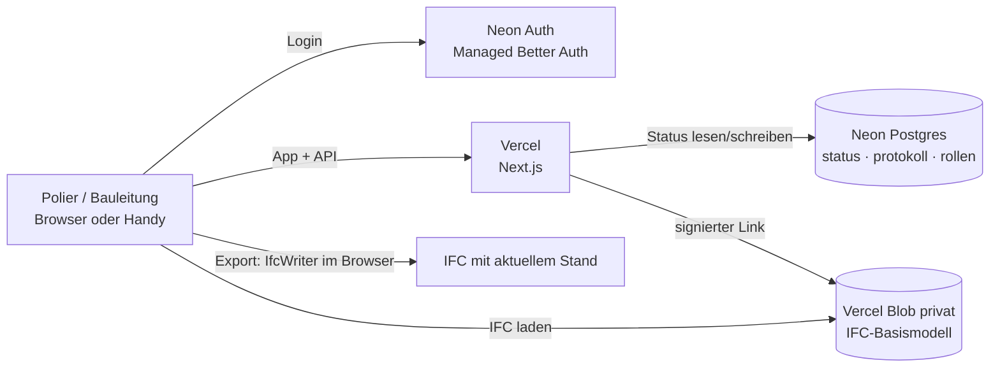

# Zielbild Variante B · Baustellen-App mit Server (Vercel + Neon)

Stand 15.11.2026 · grobe Übersicht, noch keine Umsetzung · Grundlage: [Konzept_Baustellen-App.md](Konzept_Baustellen-App.md), Abschnitt «Variante B»

## Ziel

Heute (Variante A) speichert jede Person mit «Stand speichern» eine neue IFC-Datei. Arbeiten zwei Personen mit verschiedenen Ständen, überschreibt die spätere Datei die Meldungen der früheren (grösstes Risiko auf dem Poster).

In Variante B liegen die Rückmeldungen **pro GlobalId in einer Datenbank** und nicht mehr in einer Datei. Jede Meldung ist ein eigener Datensatz:

- Zwei Poliere an verschiedenen Bauteilen kommen sich nie in die Quere.
- Am selben Bauteil gilt: Wer mit einem veralteten Stand speichert, bekommt eine Meldung («Bauteil wurde inzwischen von … geändert») und überschreibt nichts.
- Ein Protokoll hält fest, wer wann was gemeldet hat. Damit gibt es nebenbei ein **Ist-Datum der Montage**.

## Architektur in einem Satz

Das IFC-Modell liefert weiterhin Geometrie und Soll-Daten. Neon speichert Benutzer, Rollen und den Status pro GlobalId, Vercel hostet die App und eine kleine API. Ein IFC mit aktuellem Stand entsteht auf Knopfdruck im Browser.



## Was wir wiederverwenden

Die Ansichten senden ihre Änderungen schon heute als Nachricht an die umgebende Seite (`bs-inst`, `bs-acc`, `bs-soll`, `bs-instfix` in `src/app.html`). Darum muss nur die **Hülle** (`src/app.html`) neu gebaut werden:

| Heute (Variante A) | Variante B |
|---|---|
| Login per Passwort-Hash im Browser | Login über Neon Auth, Rolle aus der Datenbank, Prüfung auf dem Server |
| IFC-Datei aus dem gemeinsamen Ordner öffnen | Basismodell vom Server laden, Status aus der Datenbank mit `IfcWriter` darüberlegen |
| «Stand speichern» lädt ein neues IFC herunter | «Stand speichern» schickt nur die Änderungen an die API |
| – | «IFC exportieren»: `IfcWriter.write(Basismodell, alle Status)` im Browser, gleiche Regeln wie heute (übrige Zeilen byte-gleich) |
| `polier.html`, `bauleitung.html`, Prüflogik, 3D | **unverändert** übernehmen |

## Schritte und Aufwand (grob)

Schätzung für uns beide mit Claude Code, in Stunden. Wer Next.js schon kennt, braucht eher das untere Ende.

| # | Schritt | Inhalt | Aufwand |
|---|---|---|---|
| 0 | Entscheide | Rollen (Polier, Bauleitung, Admin), wer legt Benutzer an, welche Modelle (Mutthornhütte, Snowdon), Region | 1 h |
| 1 | Neon einrichten | Projekt in Region Frankfurt (`aws-eu-central-1`), Auth aktivieren, freie Registrierung abschalten, Benutzer anlegen | 1–2 h |
| 2 | Datenbank-Schema | Tabellen unten anlegen, Migration als SQL-Datei im Repo | 2 h |
| 3 | Next.js-Projekt | `apps/baustellen-server/`, `@neon/auth`, Anmeldeseite, Schutz der Seiten (`proxy.ts`), Rolle nach dem Login lesen | 4–6 h |
| 4 | API | `GET /api/stand` (alle Status eines Modells), `POST /api/meldungen` (Änderungen mit Version), Rechte und Regeln auf dem Server | 6–8 h |
| 5 | Modell ablegen | Basismodell als privater Vercel Blob, Upload nur Admin/Bauleitung, Download über signierten Link | 3–4 h |
| 6 | Hülle umbauen | `app.html` als Seite in Next.js: Modell + Status laden, Ansichten im iframe wie heute, Speichern an die API, Konflikte anzeigen, «Neuer Stand verfügbar» (Abfrage alle 30 s) | 6–10 h |
| 7 | IFC-Export | Knopf «IFC exportieren» mit dem bestehenden `IfcWriter` | 1–2 h |
| 8 | Vercel | Projekt mit GitHub verbinden, Umgebungsvariablen, Function-Region `fra1`, Deployment auf `*.vercel.app` | 1–2 h |
| 9 | Tests | Zwei Browser gleichzeitig (Konflikt), Rechte (Polier darf nicht abnehmen), Mutthorn-Tag aus dem README mit denselben Zahlen, Export mit IfcOpenShell validieren und mit Variante A vergleichen, Handy | 4–6 h |
| 10 | Doku | README, Anleitung, AIA-BEP-Matrix (Werkzeuge), Prozess, Poster, `KI-USAGE.md` | 2–3 h |
| | **Total** | | **ca. 30–45 h** |

## Datenbank (Vorschlag)

```sql
-- Ein Eintrag pro hochgeladenem Basismodell
create table modell (
  id          serial primary key,
  name        text not null,              -- z. B. 'Mutthornhütte'
  blob_url    text not null,              -- privater Vercel Blob
  hochgeladen timestamptz not null default now()
);

-- Aktueller Stand pro Bauteil (ersetzt die Werte im IFC)
create table status (
  modell_id         int  references modell(id),
  global_id         char(22),
  is_installed      boolean,
  acceptance_date   date,
  installation_date date,                 -- nur Korrektur durch die Bauleitung, sonst leer = Wert aus dem IFC
  version           int  not null default 0,
  geaendert_von     text,
  geaendert_am      timestamptz,
  primary key (modell_id, global_id)
);

-- Jede Meldung, nur anhängen (Ist-Datum, Nachvollziehbarkeit)
create table protokoll (
  id        bigserial primary key,
  modell_id int, global_id char(22),
  feld      text, alt text, neu text,
  von       text, rolle text,
  am        timestamptz not null default now()
);

-- Rolle pro Benutzer aus Neon Auth
create table rolle (
  user_id text primary key,               -- Benutzer-ID aus Neon Auth
  rolle   text not null check (rolle in ('polier','bauleitung','admin'))
);
```

## Kein Überschreiben: so funktioniert es

1. Die App lädt zu jedem Bauteil den Status **mit Versionsnummer**.
2. Beim Speichern schickt sie pro Bauteil die neue Angabe und die Version, die sie kennt.
3. Die API schreibt nur, wenn die Version noch stimmt:
   `update status set …, version = version + 1 where modell_id = $1 and global_id = $2 and version = $3`
4. Trifft das auf kein Bauteil zu, hat jemand anderes inzwischen gespeichert. Die API meldet einen Konflikt (HTTP 409) mit dem aktuellen Wert, und die App zeigt ihn an. Alle anderen Bauteile werden normal gespeichert.
5. Jede gespeicherte Änderung landet zusätzlich im `protokoll`.

Die Regeln, die heute im Browser stehen, prüft dann der Server: Der Polier setzt nur `IsInstalled` und nicht bei abgenommenen Bauteilen. Die Bauleitung setzt `AcceptanceDate` nur bei montierten Bauteilen und höchstens bis heute. `InstallationDate` korrigiert nur die Bauleitung.

## Stolpersteine

- **Grösse des Modells:** Vercel Functions übertragen höchstens 4,5 MB pro Anfrage oder Antwort. Das Snowdon-Modell hat 9,5 MB. Darum wird das IFC direkt aus dem Browser zu Vercel Blob hochgeladen und über einen signierten Link geladen, nicht über die API. Die Mutthornhütte (0,3 MB) wäre unkritisch.
- **Datenstandort:** Neon und Vercel bieten Frankfurt, aber keine Region in der Schweiz. Für den MVP mit Lehrmodellen ist das in Ordnung. Für echte Bauherrendaten müssten wir das offen benennen (Konzept: «Daten des Bauherrn in der Schweiz»).
- **Kosten:** Für zwei bis zehn Benutzer und zwei Modelle sollten die Gratis-Stufen (Neon Free, Vercel Hobby, Blob) reichen. Die aktuellen Grenzen vor dem Start prüfen. Vercel Hobby ist nur für nicht-kommerzielle Projekte gedacht, das passt zur Studienarbeit.
- **Offline:** Ohne Netz kann man in Variante B nicht speichern. Eine Offline-Fähigkeit mit Zwischenspeicher und späterer Synchronisation (PWA) wäre ein weiterer Schritt (geschätzt 10–15 h) und bleibt Ausblick.
- **Zeitplan:** Im Pitch steht «ab 29.11. keine neuen Funktionen». 30–45 h passen nur bis dahin, wenn wir sofort beginnen und Variante A als funktionierende Rückfallebene behalten.

## Vorschlag zum Vorgehen

1. **Durchstich zuerst (ca. 10 h):** Login, ein Modell, Polier meldet `IsInstalled`, Konflikt bei zwei Browsern sichtbar. Damit ist das grösste Risiko belegt gelöst.
2. Danach Bauleitung (Abnahme, Korrektur), Export und Tests.
3. Variante A bleibt im Repo und funktioniert weiter. Das Poster zeigt Variante B als «in Arbeit» oder «umgesetzt», je nach Stand am 15.12.
